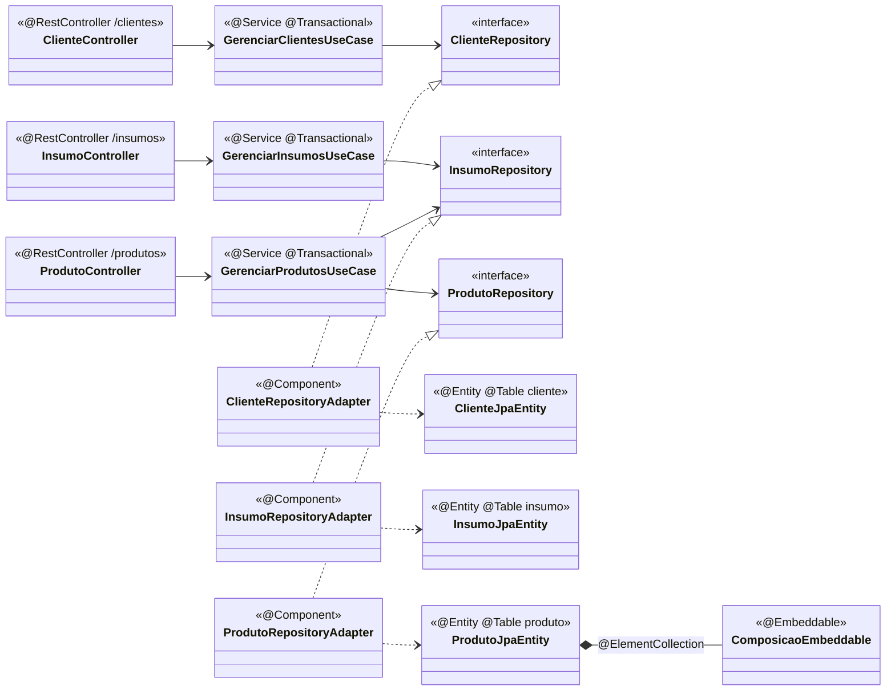
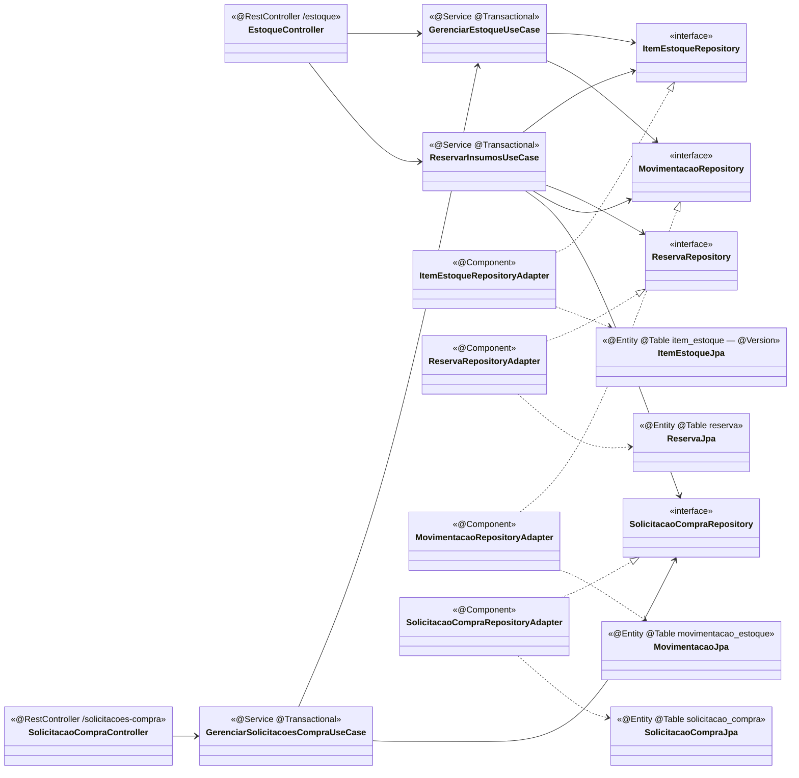
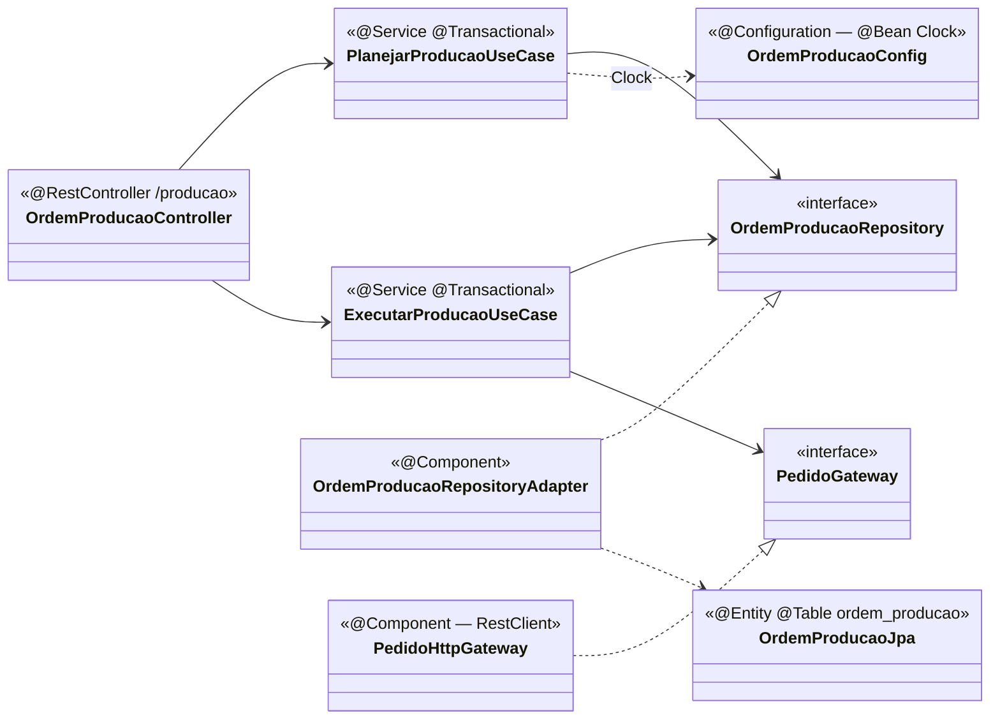
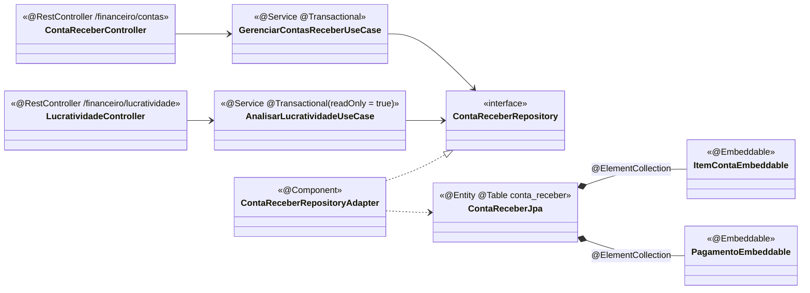
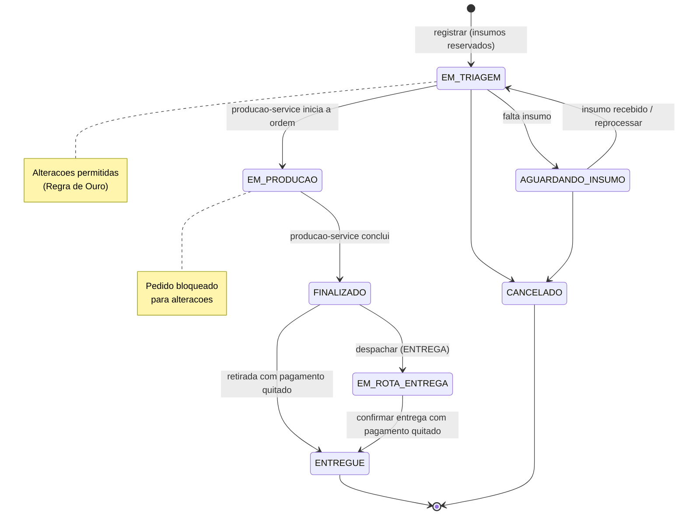

# Diagrama de Classes UML — 3D Control

Modelo de domínio de cada microsserviço (camada `domain`) e, em seguida, os componentes Spring de cada
serviço com as **anotações** que cada classe usa (indicadas no estereótipo `«…»`).
As setas tracejadas entre serviços representam **referências apenas por identificador** (UUID): cada serviço
tem o próprio banco e não há chave estrangeira entre bancos.

> Fonte PlantUML equivalente (2 diagramas: domínio e camadas do `pedido-service` com anotações):
> [`diagrama-classes.puml`](diagrama-classes.puml)
> (abra no plugin PlantUML do IntelliJ/VS Code ou em https://www.plantuml.com/plantuml para exportar PNG/SVG).

## Visão geral do domínio (todos os contextos)

Classes de domínio: Java puro, **sem anotações** de Spring ou JPA.

## pedido-service — camadas e anotações Spring

Cada classe mostra no estereótipo `«…»` as anotações que leva no código. As classes de domínio
(`Pedido`, `ItemPedido`…) **não têm anotações**: são Java puro. Os casos de uso dependem apenas das
**portas** (interfaces), e os adaptadores da infraestrutura as implementam.

```mermaid
classDiagram
    direction TB

    class PedidoServiceApplication {
        <<@SpringBootApplication>>
        +main(String[] args)$
    }

    %% ---------- infrastructure.web ----------
    class PedidoController {
        <<@RestController @RequestMapping /pedidos>>
        +registrar(@Valid @RequestBody NovoPedidoRequest) PedidoResponse
        +alterar(@PathVariable UUID, @Valid @RequestBody AlteracaoRequest) PedidoResponse
        +confirmarEntrega(@PathVariable UUID) PedidoResponse
        +cancelar(@PathVariable UUID, @RequestBody CancelamentoRequest) PedidoResponse
    }
    class RastreioController {
        <<@RestController @RequestMapping /rastreio>>
        +rastrear(@PathVariable String codigo) Rastreio
    }
    class GlobalExceptionHandler {
        <<@RestControllerAdvice>>
        +naoEncontrado() ProblemDetail 404
        +regraDeNegocio() ProblemDetail 422
        +concorrencia() ProblemDetail 409
        +integracao() ProblemDetail 503
    }

    %% ---------- application ----------
    class RegistrarPedidoUseCase {
        <<@Service @Transactional>>
        +executar(NovoPedido cmd) Pedido
    }
    class AlterarPedidoUseCase {
        <<@Service @Transactional>>
        +executar(UUID id, AlteracaoPedido cmd) Pedido
    }
    class MovimentarPedidoUseCase {
        <<@Service @Transactional>>
        +reprocessarInsumos(UUID id) Pedido
        +iniciarProducao(UUID id) Pedido
        +finalizarProducao(UUID id) Pedido
        +despachar(UUID id) Pedido
        +confirmarEntrega(UUID id) Pedido
        +cancelar(UUID id, String motivo) Pedido
    }
    class ConsultarPedidosUseCase {
        <<@Service @Transactional(readOnly = true)>>
        +buscar(UUID id) Pedido
        +listar(StatusPedido s, UUID clienteId) List~Pedido~
    }
    class RastrearPedidoUseCase {
        <<@Service @Transactional(readOnly = true)>>
        +rastrear(String codigo) Rastreio
    }
    class MontadorItensPedido {
        <<@Component>>
        +montar(List~ItemCommand~ itens) ItensResolvidos
        +necessidades(List~ItemPedido~ itens) List~InsumoNecessario~
    }

    %% ---------- portas (interfaces da aplicação/domínio) ----------
    class PedidoRepository {
        <<interface>>
        +salvar(Pedido p) Pedido
        +buscarPorId(UUID id) Optional~Pedido~
        +buscarPorCodigo(String codigo) Optional~Pedido~
    }
    class CadastroGateway {
        <<interface>>
    }
    class EstoqueGateway {
        <<interface>>
    }
    class ProducaoGateway {
        <<interface>>
    }
    class FinanceiroGateway {
        <<interface>>
    }

    %% ---------- domain (sem anotações) ----------
    class Pedido {
        <<domain — sem anotações>>
    }

    %% ---------- infrastructure.persistence ----------
    class PedidoRepositoryAdapter {
        <<@Component>>
    }
    class PedidoJpaRepository {
        <<interface — Spring Data>>
        extends JpaRepository~PedidoJpa, UUID~
        +findByCodigo(String codigo) Optional~PedidoJpa~
    }
    class PedidoJpa {
        <<@Entity @Table pedido>>
        @Id UUID id
        @Enumerated StatusPedido status
        @Version Long versao
        @ElementCollection List~ItemPedidoEmbeddable~ itens
        @ElementCollection List~HistoricoEmbeddable~ historico
        +from(Pedido p)$ PedidoJpa
        +toDomain() Pedido
    }
    class ItemPedidoEmbeddable {
        <<@Embeddable>>
    }
    class HistoricoEmbeddable {
        <<@Embeddable>>
    }

    %% ---------- infrastructure.client ----------
    class CadastroHttpGateway {
        <<@Component — RestClient>>
    }
    class EstoqueHttpGateway {
        <<@Component — RestClient>>
    }
    class ProducaoHttpGateway {
        <<@Component — RestClient>>
    }
    class FinanceiroHttpGateway {
        <<@Component — RestClient>>
    }

    PedidoController --> RegistrarPedidoUseCase
    PedidoController --> AlterarPedidoUseCase
    PedidoController --> MovimentarPedidoUseCase
    PedidoController --> ConsultarPedidosUseCase
    RastreioController --> RastrearPedidoUseCase

    RegistrarPedidoUseCase --> MontadorItensPedido
    AlterarPedidoUseCase --> MontadorItensPedido
    RegistrarPedidoUseCase --> PedidoRepository
    RegistrarPedidoUseCase --> CadastroGateway
    RegistrarPedidoUseCase --> EstoqueGateway
    RegistrarPedidoUseCase --> ProducaoGateway
    RegistrarPedidoUseCase --> FinanceiroGateway
    MovimentarPedidoUseCase --> PedidoRepository
    RastrearPedidoUseCase --> PedidoRepository
    MontadorItensPedido --> CadastroGateway
    RegistrarPedidoUseCase ..> Pedido : cria
    PedidoRepository ..> Pedido

    PedidoRepositoryAdapter ..|> PedidoRepository
    PedidoRepositoryAdapter --> PedidoJpaRepository
    PedidoJpaRepository ..> PedidoJpa
    PedidoJpa *-- ItemPedidoEmbeddable
    PedidoJpa *-- HistoricoEmbeddable
    PedidoJpa ..> Pedido : converte
    CadastroHttpGateway ..|> CadastroGateway
    EstoqueHttpGateway ..|> EstoqueGateway
    ProducaoHttpGateway ..|> ProducaoGateway
    FinanceiroHttpGateway ..|> FinanceiroGateway
```

## Demais serviços — componentes Spring

Todos seguem o mesmo padrão: `@RestController` → `@Service @Transactional` → porta (`interface`) ←
adaptador `@Component` → `JpaRepository` → `@Entity`. Cada serviço também tem um
`@SpringBootApplication` e um `GlobalExceptionHandler` (`@RestControllerAdvice`).

### cadastro-service

### estoque-service

### producao-service

### financeiro-service

### Resumo das anotações por camada

| Camada | Anotações usadas | Exemplos |
|---|---|---|
| raiz do serviço | `@SpringBootApplication` | `PedidoServiceApplication` |
| `infrastructure.web` | `@RestController`, `@RequestMapping`, `@GetMapping`/`@PostMapping`/…, `@Valid`, `@RequestBody`, `@PathVariable`, `@RestControllerAdvice`, `@ExceptionHandler` | `PedidoController`, `GlobalExceptionHandler` |
| `application` | `@Service`, `@Transactional`, `@Transactional(readOnly = true)`, `@Component` | `RegistrarPedidoUseCase`, `MontadorItensPedido` |
| `infrastructure.persistence` | `@Component`, `@Entity`, `@Table`, `@Id`, `@Column`, `@Enumerated`, `@Version`, `@ElementCollection`, `@CollectionTable`, `@Embeddable` | `PedidoJpa`, `PedidoRepositoryAdapter` |
| `infrastructure.client` | `@Component`, `@Value` | `EstoqueHttpGateway` |
| `infrastructure.config` | `@Configuration`, `@Bean` | `OrdemProducaoConfig` (relógio) |
| `domain` | **nenhuma** (Java puro) | `Pedido`, `ContaReceber`, `ItemEstoque` |

## Máquina de estados do Pedido

