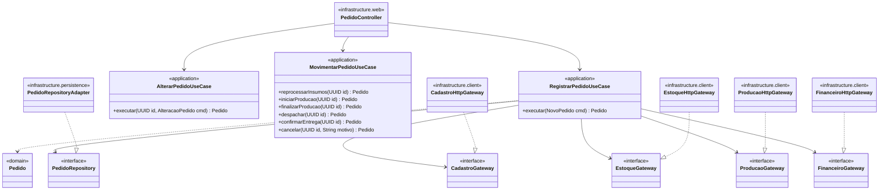
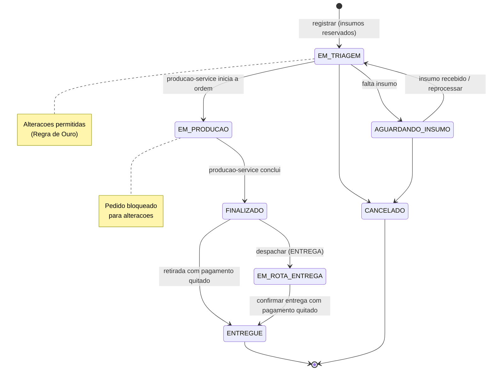

# Diagrama de Classes UML — 3D Control

Modelo de domínio de cada microsserviço (camada `domain`), com os casos de uso e portas principais.
As setas tracejadas entre serviços representam **referências apenas por identificador** (UUID): cada serviço
tem o próprio banco e não há chave estrangeira entre bancos.

> Fonte PlantUML equivalente: [`diagrama-classes.puml`](diagrama-classes.puml)
> (abra no plugin PlantUML do IntelliJ/VS Code ou em https://www.plantuml.com/plantuml para exportar PNG/SVG).

## Visão geral (todos os contextos)

```mermaid
classDiagram
    direction LR

    namespace cadastro_service {
        class Cliente {
            -UUID id
            -String nome
            -String documento
            -String telefone
            -String email
            -CanalAtendimento canalPreferencial
            -String preferenciasPersonalizacao
            -boolean ativo
            +novo()$ Cliente
            +atualizar() void
            +inativar() void
        }
        class Produto {
            -UUID id
            -String nome
            -String categoria
            -String especificacoesTecnicas
            -int tempoMedioFabricacaoHoras
            -BigDecimal precoBase
            -boolean ativo
            +calcularCustoInsumos(Map custos) BigDecimal
            +atualizar() void
        }
        class ComposicaoProduto {
            <<record>>
            +UUID insumoId
            +BigDecimal quantidade
        }
        class Insumo {
            -UUID id
            -String nome
            -UnidadeMedida unidadeMedida
            -BigDecimal custoUnitario
            -boolean usoRegular
            -boolean ativo
        }
    }

    namespace pedido_service {
        class Pedido {
            <<aggregate root>>
            -UUID id
            -String codigo
            -UUID clienteId
            -CanalAtendimento canalOrigem
            -String atendenteResponsavel
            -LocalDate prazoEntrega
            -ModalidadeEntrega modalidadeEntrega
            -CondicaoPagamento condicaoPagamento
            -StatusPedido status
            -Long versao
            +registrar()$ Pedido
            +garantirAlteravel() void
            +alterar() void
            +atualizarDisponibilidadeInsumos(boolean ok) void
            +iniciarProducao() void
            +finalizarProducao() void
            +despachar() void
            +confirmarEntrega(boolean quitado, BigDecimal saldo) void
            +cancelar(String motivo) void
            +valorTotal() BigDecimal
        }
        class ItemPedido {
            <<record>>
            +UUID produtoId
            +String nomeProduto
            +String categoria
            +int quantidade
            +BigDecimal precoUnitario
            +BigDecimal custoUnitarioEstimado
            +String personalizacao
            +subtotal() BigDecimal
        }
        class HistoricoStatus {
            <<record>>
            +StatusPedido status
            +LocalDateTime dataHora
            +String observacao
        }
        class StatusPedido {
            <<enumeration>>
            EM_TRIAGEM
            AGUARDANDO_INSUMO
            EM_PRODUCAO
            FINALIZADO
            EM_ROTA_ENTREGA
            ENTREGUE
            CANCELADO
            +permiteAlteracao() boolean
            +podeTransitarPara(StatusPedido d) boolean
        }
    }

    namespace estoque_service {
        class ItemEstoque {
            <<aggregate root>>
            -UUID insumoId
            -BigDecimal quantidadeDisponivel
            -BigDecimal quantidadeReservada
            -BigDecimal estoqueMinimo
            -Long versao
            +registrarEntrada(BigDecimal q) void
            +saldoLivre() BigDecimal
            +reservar(BigDecimal q) void
            +consumirReserva(BigDecimal q) void
            +liberarReserva(BigDecimal q) void
            +abaixoDoMinimo() boolean
        }
        class Reserva {
            -UUID pedidoId
            -UUID insumoId
            -BigDecimal quantidade
            -Status status
            +consumir() void
            +cancelar() void
        }
        class MovimentacaoEstoque {
            <<record>>
            +UUID insumoId
            +Tipo tipo
            +BigDecimal quantidade
            +UUID pedidoId
            +LocalDateTime dataHora
        }
        class SolicitacaoCompra {
            -UUID insumoId
            -BigDecimal quantidade
            -UUID pedidoId
            -Status status
            +registrarRecebimento() void
            +cancelar() void
        }
    }

    namespace producao_service {
        class OrdemProducao {
            <<aggregate root>>
            -UUID pedidoId
            -String codigoPedido
            -LocalDate prazoEntrega
            -boolean insumosDisponiveis
            -StatusOrdem status
            -String responsavel
            -int retrabalhos
            +replanejar(LocalDate prazo, boolean insumos) void
            +iniciar(String responsavel) void
            +registrarRetrabalho(String motivo) void
            +concluir() void
            +prioridade(LocalDate hoje) Prioridade
        }
        class FilaProducao {
            <<domain service>>
            +ordenar(List ordens, LocalDate hoje)$ List
        }
        class Prioridade {
            <<enumeration>>
            URGENTE
            ALTA
            NORMAL
            BAIXA
        }
    }

    namespace financeiro_service {
        class ContaReceber {
            <<aggregate root>>
            -UUID pedidoId
            -UUID clienteId
            -StatusConta status
            +registrarPagamento(BigDecimal v, FormaPagamento f) Pagamento
            +atualizarItens(List itens) void
            +liberadaParaEntrega() boolean
            +saldoRemanescente() BigDecimal
            +cancelar() void
        }
        class ItemConta {
            <<record>>
            +String categoria
            +BigDecimal valorVenda
            +BigDecimal custoEstimado
        }
        class Pagamento {
            <<record>>
            +BigDecimal valor
            +TipoPagamento tipo
            +FormaPagamento forma
            +LocalDateTime pagoEm
        }
        class AnaliseLucratividade {
            <<domain service>>
            +porCategoria(List contas)$ List
        }
    }

    Produto "1" *-- "0..*" ComposicaoProduto : ficha tecnica
    ComposicaoProduto ..> Insumo : insumoId
    Pedido "1" *-- "1..*" ItemPedido
    Pedido "1" *-- "1..*" HistoricoStatus : rastreio
    Pedido --> StatusPedido
    ItemEstoque "1" -- "0..*" Reserva
    ItemEstoque "1" -- "0..*" MovimentacaoEstoque
    OrdemProducao ..> Prioridade
    FilaProducao ..> OrdemProducao
    ContaReceber "1" *-- "1..*" ItemConta
    ContaReceber "1" *-- "0..*" Pagamento
    AnaliseLucratividade ..> ContaReceber

    Pedido ..> Cliente : clienteId
    ItemPedido ..> Produto : produtoId
    ItemEstoque ..> Insumo : insumoId
    Reserva ..> Pedido : pedidoId
    SolicitacaoCompra ..> Pedido : pedidoId
    OrdemProducao ..> Pedido : pedidoId
    ContaReceber ..> Pedido : pedidoId
```

## pedido-service — camadas (Arquitetura Limpa)

Exemplo de como cada feature se organiza: o caso de uso depende apenas de **portas** (interfaces);
os **adaptadores** da infraestrutura as implementam.

## Máquina de estados do Pedido

