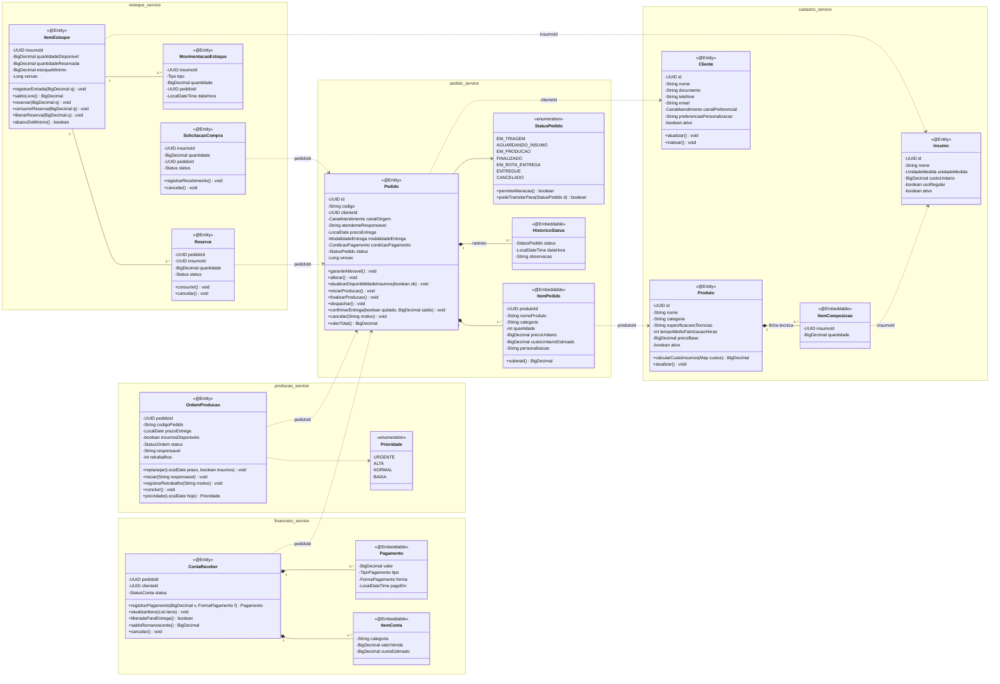
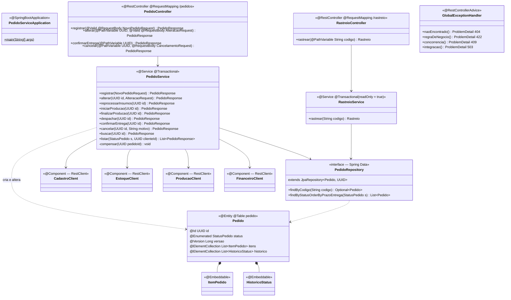
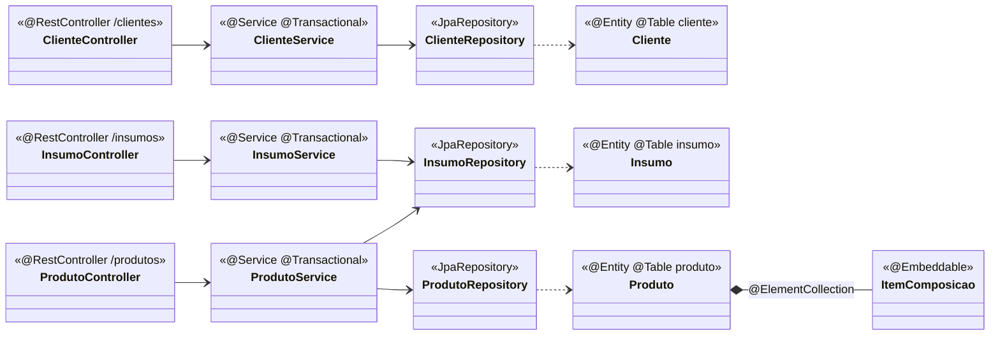
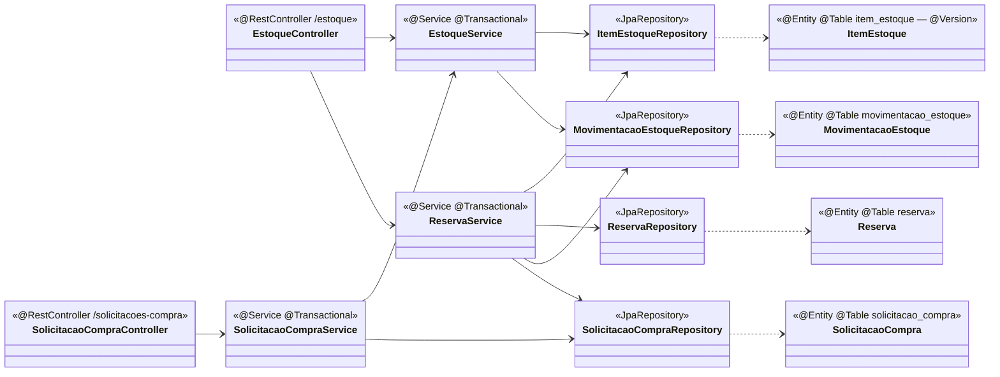
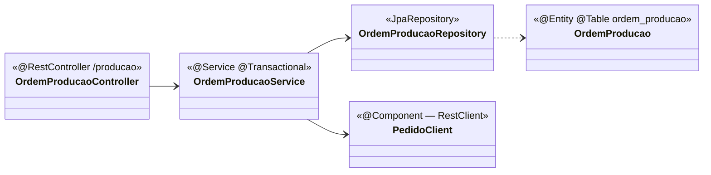
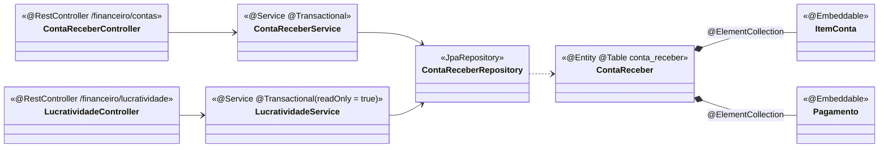
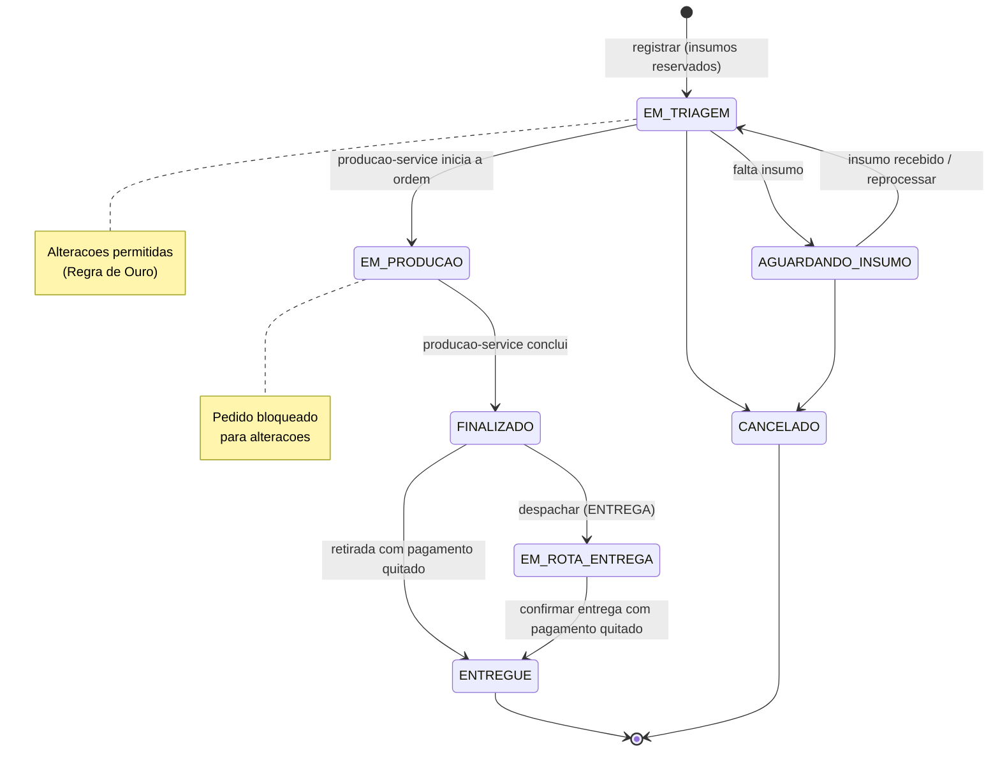

# Diagrama de Classes UML — 3D Control

Entidades de cada microsserviço e, em seguida, os componentes Spring de cada serviço com as
**anotações** que cada classe usa (indicadas no estereótipo `«…»`).
As setas tracejadas entre serviços representam **referências apenas por identificador** (UUID): cada serviço
tem o próprio banco e não há chave estrangeira entre bancos.

> Fonte PlantUML equivalente (2 diagramas: entidades e camadas do `pedido-service` com anotações):
> [`diagrama-classes.puml`](diagrama-classes.puml)
> (abra no plugin PlantUML do IntelliJ/VS Code ou em https://www.plantuml.com/plantuml para exportar PNG/SVG).

## Entidades (todos os serviços)

As entidades são classes JPA (`@Entity`; as partes que não têm tabela própria são `@Embeddable`) e também
guardam as **regras de negócio**: o estado só muda pelos métodos mostrados abaixo, que validam cada operação.

## pedido-service — camadas e anotações Spring

Cada classe mostra no estereótipo `«…»` as anotações que leva no código. O fluxo é sempre
**Controller → Service → Repository / Client**, e a entidade `Pedido` guarda as regras.

## Demais serviços — componentes Spring

Todos seguem o mesmo padrão: `@RestController` → `@Service @Transactional` → `JpaRepository` →
`@Entity`. Cada serviço também tem um `@SpringBootApplication` e um `GlobalExceptionHandler`
(`@RestControllerAdvice`).

### cadastro-service

### estoque-service

### producao-service

### financeiro-service

### Resumo das anotações por tipo de classe

| Tipo de classe | Anotações usadas | Exemplos |
|---|---|---|
| raiz do serviço | `@SpringBootApplication` | `PedidoServiceApplication` |
| Controller | `@RestController`, `@RequestMapping`, `@GetMapping`/`@PostMapping`/…, `@Valid`, `@RequestBody`, `@PathVariable` | `PedidoController` |
| Tratamento de erros | `@RestControllerAdvice`, `@ExceptionHandler` | `GlobalExceptionHandler` |
| Service | `@Service`, `@Transactional`, `@Transactional(readOnly = true)` | `PedidoService`, `ReservaService` |
| Repository | nenhuma (interface que estende `JpaRepository`) | `PedidoRepository` |
| Entidade | `@Entity`, `@Table`, `@Id`, `@Column`, `@Enumerated`, `@Version`, `@ElementCollection`, `@CollectionTable`, `@Embeddable` | `Pedido`, `ItemPedido` |
| Cliente HTTP | `@Component`, `@Value` | `EstoqueClient` |
| DTOs | `@NotNull`, `@NotBlank`, `@Positive`, `@DecimalMin`… (Bean Validation) | `PedidoDtos` |

## Máquina de estados do Pedido

